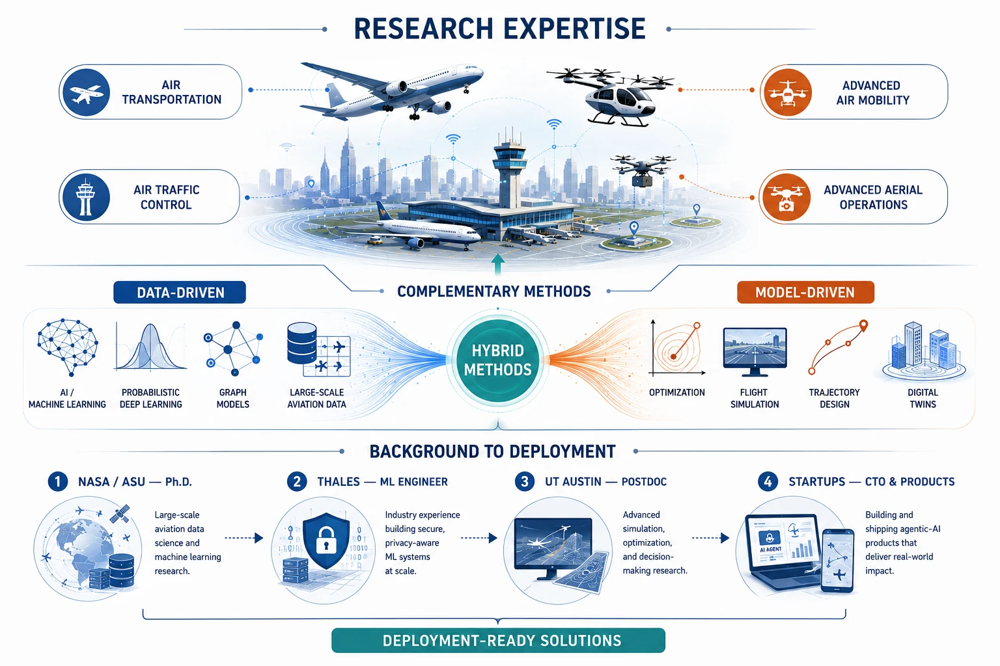

I am a postdoctoral research fellow in the Department of Aerospace Engineering & Engineering Mechanics at The University of Texas at Austin, working with Prof. John-Paul Clarke. My research focuses on **smart aviation**, **including air transportation, air traffic control, advanced air mobility, and advanced aerial operations**. I use both **methods that learn from data (machine learning and AI) and methods based on models (optimization and simulations)**. My work cuts across disciplines, spanning aerospace engineering, data science and artificial intelligence, computer engineering, transportation engineering, industrial engineering and operations research, human factors, and geographic information systems.

My path has crossed the spectrum from models to data in stages. My Ph.D. at Arizona State University, sponsored by a NASA aviation data science project that ran five years, was data-driven work: from probabilistic deep learning to graph models that predict air traffic behavior from operational data at massive scale. My postdoc at UT Austin has added the model-driven side, with flight simulation, trajectory optimization, and hybrid methods that couple the two traditions. Throughout, the solutions are built to be ready for deployment, rather than merely staying on paper.

Alongside academia, I have **industry experience**. I worked full-time at Thales Group as a machine learning engineer in San Jose, California, where I built a background in security and privacy research for critical industries. A solution I developed there, an embedding protection tool, is now part of the Thales data security platform. Moreover, experience at **multiple startups** (across aerospace, autonomous driving, and healthcare) has demonstrated my capacity for **bold innovation and hands on execution**, delivering products across different industries. Currently, I serve as **co-founder and CTO of [Wyzzy](https://wyzzy.ai/)**, an agentic-AI healthcare startup whose product is deployed in dental offices in Dallas, Texas.

_I am always open to collaborations and am actively looking for research opportunities worldwide. Please reach me at **yutian DOT pang AT outlook DOT com**, or send me a direct message through the panel on the right edge of this page._

Research areas
======
* **Decision-making and optimization under uncertainty** — *what should we do?* Allocating scarce resources such as runways, airspace, and vehicle fleets, and designing schedules and trajectories, when demand, weather, and human behavior are only known probabilistically, from strategic planning down to real-time control.
* **Safety, risk, and reliability of increasingly autonomous operations** — *how safe is it, and can we prove it?* Quantifying how communication, human, and autonomy uncertainties bound the capacity and reliability of operations, combining data-driven learning with the rigor and guarantees of model-based analysis.
* **Human–AI teaming in safety-critical operations** — *how do humans stay in command?* Understanding pilot and controller communication and workload, and designing decision support that complements rather than replaces human judgment.
* **Prediction of air traffic behavior under uncertainty** — *what will the system do?* Learning how aircraft, traffic flows, and airspace demand evolve from operational data, with calibrated uncertainty attached to every prediction so it can inform real decisions.

Selected publications
======


Visitors
======

